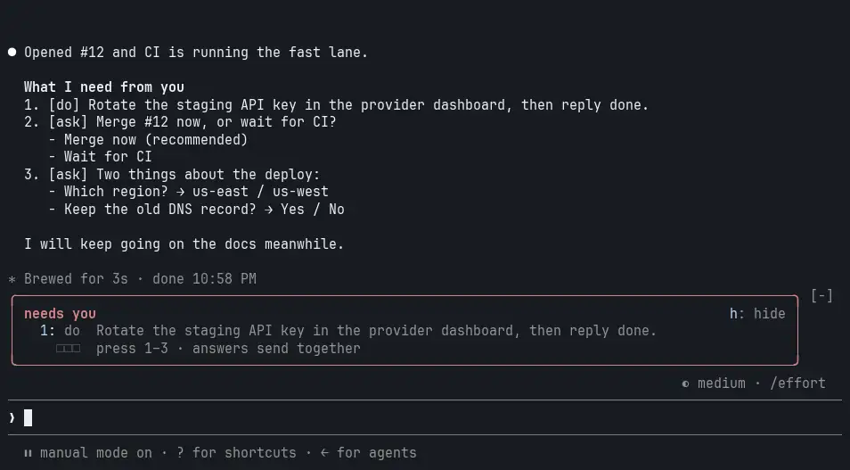
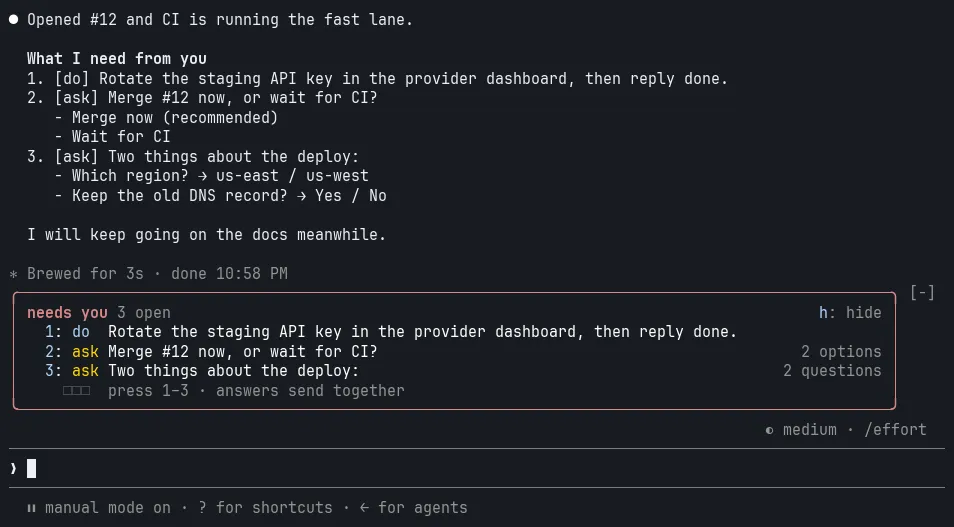
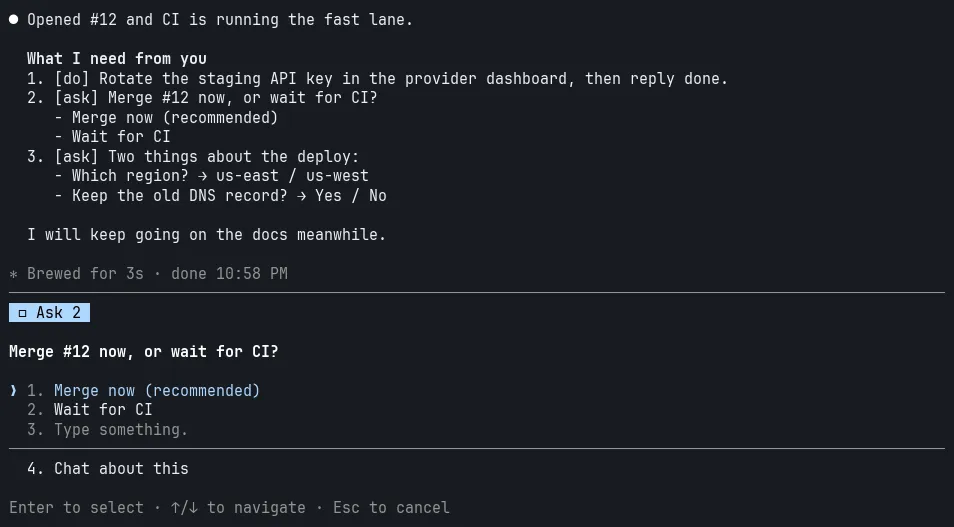
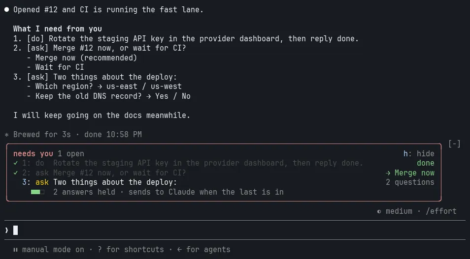
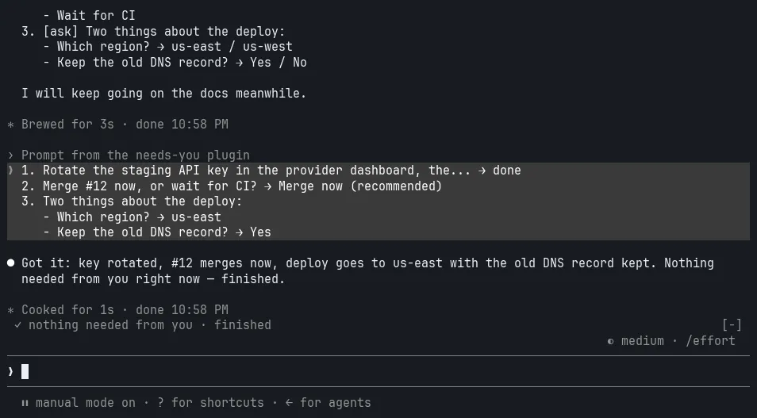

# needs-you

> **Deprecated.** needs-you is no longer maintained and has been removed from the [mrhodes catalog](https://github.com/MasonRhodesDev/claude-plugins). Existing installs keep working, but they get no updates. To remove it, run `/plugin uninstall needs-you@mrhodes`.

A Claude Code plugin. Every reply ends with a numbered list of what Claude needs from you, and a band above the prompt turns that list into keys you press.



Inspired by Convex's video [I fixed Claude to MASSIVELY boost my productivity](https://www.youtube.com/watch?v=fXETGbqwrng), which ends every turn with a "What I need from you" list using a few lines in CLAUDE.md. needs-you carries that rule in the system prompt, types each item, and adds the band.

## Install

At the Claude Code prompt:

```
/plugin marketplace add MasonRhodesDev/claude-plugins
/plugin install needs-you@mrhodes
```

Or from this repository alone:

```
/plugin install needs-you --marketplace MasonRhodesDev/needs-you
```

No CLAUDE.md edit is needed.

## What Claude writes

```markdown
**What I need from you**
1. [do] Rotate the staging API key in the provider dashboard, then reply done.
2. [ask] Merge #12 now, or wait for CI?
   - Merge now (recommended)
   - Wait for CI
3. [ask] Two things about the deploy:
   - Which region? → us-east / us-west
   - Keep the old DNS record? → Yes / No
```

| Kind | For | Pressing its digit |
|---|---|---|
| `[do]` | Something done outside the chat: a site, an app, a command | Marks it done |
| `[ask]` | A decision, or questions only you can answer | Opens Claude Code's question dialog, one question at a time |

An untagged item counts as `[do]`. When nothing is needed, Claude says "Nothing needed from you right now" and whether the work is finished or still going.

## The band

| State | |
|---|---|
| Open items, with option and question counts |  |
| An `[ask]` in Claude Code's own dialog |  |
| Answers held, each read back on its row |  |
| Sent, then a one-line state that fades |  |

## Keys

| Key | Where | Does |
|---|---|---|
| `1`–`9` | An empty prompt, or the focused band | Acts on that item |
| `h` | The focused band | Hides the band until the next list |
| `ctrl+x tab` | Anywhere | Focuses the band |

Items past 9 are clicked.

## Behavior

- Answers are held until every item has one, then sent to Claude as one message of yours.
- A message you send first carries the answers held so far, once.
- Dismissing the dialog keeps the item open; a multi-question item drops its partial answers.
- A reply with no list keeps the open items, marked "from an earlier reply". "Nothing needed" clears them.
- Below 80 columns of band width, the right-hand detail column is dropped.
- Colors are Claude Code theme keys (`claude`, `suggestion`, `warning`, `success`, `inactive`, `subtle`), so the band follows your theme.
- Glyphs are limited to ones every common monospace font has: `✓ ○ ■ □ · ∙ ● →`.
- The rule is skipped for agent-team teammates and `claude -p`. Subagents' replies never reach the band.

## Limits

- The question dialog takes options only. A question with none gets Yes/No plus "Type something", so the rule asks Claude for 2–4 options every time.
- Where an organization manages Claude Code, plugins a person installs can't add to the system prompt, so the rule isn't added there. The band still reads any list Claude writes.

## Develop

```
claude plugin validate .
claude plugin test .
```

`claude --plugin-dir .` runs a session with this checkout loaded.

## License

MIT
